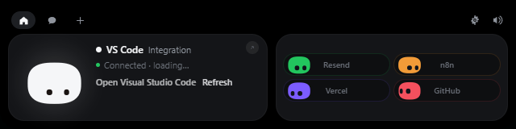

<div align="center">


# Piko for Windows

**Mochi doesn't get a notch on a PC — so it lives at the top of your screen instead.**

Approve Claude Code permissions, watch your session work, drop a file, chat with Claude, keep an eye on your services — without leaving what you're doing.


</div>


---

## Install

The downloadable installer is **temporarily unavailable**. Microsoft Defender
wrongly flags the unsigned installer as malware (`Trojan:Win32/Wacatac.H!ml`, a
machine-learning false positive). A report is under review at Microsoft, and the
installer will be published again once it is cleared and code-signed.

Until then, [build it yourself](#build-it-yourself): it takes a few minutes and
installs for the current user only — no admin prompt.

## Using it





| What you do | What happens |
|---|---|
| Move the mouse to the very top-centre of the screen | Mochi peeks out |
| Click the small island | It opens |
| Click Mochi | It gets annoyed. Three times in a row and it goes dizzy |
| Rest the pointer on Mochi for two seconds | Hearts |
| Drag a file onto the island | Mochi turns into a box, swallows it, then offers to answer questions about it |
| `Esc` | Closes the island |
| Tray icon | Open, Settings…, Pause, Quit |

Everything else happens on its own: a Claude Code permission request opens the
island with **Deny / Allow**, a finished session shows what it did, and
your integrations sit in the coloured pills next to Mochi.

## OpenCode


Open **Settings… → OpenCode**. It is a switch, not a form: on the default
**managed** side Piko owns the server it talks to — it finds the CLI, asks the OS
for a free loopback port, mints a password with the system CSPRNG, runs
`opencode serve` as a windowless child that dies with Piko, and brings it back up
to three times if it falls over. On the **manual** side you give it a URL, a
username and a password, with **Auto-detect** for an OpenCode that is already
running and **Save & test** to check them. Every one of those values lives in the
Windows Credential Manager, never on disk and never in the interface.

There is no relay executable and nothing is installed into Claude Code's
`settings.json`: the island and the agent talk to the same server over HTTP, and a
permission request is an HTTP round trip that either gets an answer or does not.

## Screen control (OpenCode MCP)

OpenCode can read the screen and drive the mouse and keyboard. Piko is the gate
between it and your desktop.

Open **Settings… → Screen control**. There are two steps, in this order:

1. **Set up in OpenCode** — shows the exact unified diff of what will change in
   `%USERPROFILE%\.config\opencode\opencode.json` (or `.opencode.jsonc`, which
   wins when both exist), and the path of the dated backup that will be taken.
   Nothing is written until you click, and the apply step carries a digest of the
   file as it was shown, so a config that changed behind the window's back is
   refused rather than overwritten.
2. **Allow screen control** — the master switch. Off in every fresh install, off
   by default everywhere else, and persisted off by the kill chord.

Then every single action still stops and asks. The island shows the card with the
action in plain words — "click at 840,420", "type 12 chars" — and waits. Only
`screen_info` runs without a card: reading the cursor position changes nothing.
`screenshot`, `read_file` and `list_directory` each ask once per run and are then
granted for the rest of it.

| Rule | Why |
|---|---|
| Off by default | An agent must never be able to touch the desktop until a person says so. |
| Every action asks | No action is pre-approved by turning the switch on. |
| `type_text` is never pre-approvable | It can type a password, so no "for this session" tick is offered. |
| 5 actions per second | A runaway loop is throttled rather than queued. |
| Grants last 10 minutes | Then the card comes back. |
| Refused on a secure desktop | UAC, the lock screen and Ctrl+Alt+Del are out of reach. |
| `Ctrl+Alt+Shift+Esc` stops everything | Instant, from anywhere, and it is persisted off. |
| Typed text is never logged | The log records the action and the time, never the arguments. |

Coordinates are physical pixels across the virtual desktop, so call `screen_info`
before guessing.

### How the two processes talk

OpenCode starts `piko.exe mcp` as a stdio MCP server. That process is a thin
bridge: it copies newline-delimited JSON between its own standard input/output and
a named pipe served by the running app — the one holding the island, the switch
and the approvals.

The pipe is `\\.\pipe\piko-mcp-<your-SID>` with a DACL granting your account and
SYSTEM, and `FILE_FLAG_FIRST_PIPE_INSTANCE` so nothing else can hold the name while
Piko runs. **There is no token, no port and no key**: a secret that never exists
cannot leak, and nothing is listening that another account can reach. If the DACL
cannot be narrowed, the pipe is not created at all.

Because Piko has to be running, the tools are unavailable until it is; OpenCode
reports that as the server failing to start.

## Chat and keys

The chat room talks to OpenCode, so the model and the provider are the ones
**OpenCode** is configured with — Piko never asks for a model key of its own. What
it does hold are the OpenCode connection values (URL, username, password) and the
integration keys, and those live in the **Windows Credential Manager**, never on
disk and never in the interface: the island can only ask whether a key exists.

No telemetry. The only network requests Piko makes are to the services you
configure yourself.

## Build it yourself

You need [Rust](https://rustup.rs), [Node 20+](https://nodejs.org), and the
**MSVC build tools** (Visual Studio Build Tools with "Desktop development with
C++"). WebView2 ships with Windows 10/11.

```powershell
cd windows
npm install
npm run tauri dev      # live-reloading development build
npm run pack           # builds the installer and drops it in windows/release/
```

`npm run dev` alone serves the front end in an ordinary browser, which is enough
to work on the island's looks. It also serves `dev/upload-preview.html`, which
replays the whole file-drop choreography on a loop — the one part of the UI that
otherwise needs a real drag from Explorer to see. Neither page ships in the app.

`npm run pack` leaves two files in `windows/release/`, the same names the release
workflow publishes:

```
Piko-Windows-X.Y.Z-setup.exe    the versioned installer
Piko-Windows-setup.exe          the same file under the rolling name
```

Installing is optional — `target/release/piko.exe` runs on its own. There is no
window in the taskbar and no console: the island at the top of the screen and the
Mochi in the notification area are the whole app, and Quit lives in its menu.

The 28 sounds are the macOS app's own files; they are never duplicated in this
folder. The path is declared once, in `SOUNDS_DIR` at the top of
`vite.config.ts` — when they move to `shared/sounds/`, change that one line.

### The app icon

`dev/icon/master-b.png` is the icon's single source. It is a **1024×1024 master
and nothing regenerates it** — it is replaced by hand, like any other artwork.

```powershell
npm run icons          # master-b.png + master-b-small.png -> src-tauri/icons
```

The script reads both masters, runs `tauri icon` on the full one, and then
re-cuts the two sizes that would otherwise be wrong: `icon.ico` is assembled by
hand because one artwork cannot be right at both 16 px and 256 px. 16/24/32 come
from `master-b-small.png` — no mouth, thicker antenna — and 48/64/256 from
`master-b.png`. The tray has no icon file of its own: `tray.rs` hands the builder
`app.default_window_icon()`, which Tauri fills from `icons/icon.ico`.

Nothing in the repo draws the old Mochi logo any more, and nothing else writes to
`dev/icon/master-b.png`.

`npm test` drives the island in headless Chrome over CDP and asserts the chosen
agent survives into `chat_send`; `npm run shot` does the same to capture the UI.

### Layout

```
windows/
  src/                 island front end (TypeScript, no framework)
    piko/              the character engine and the launch greeting, Canvas 2D
    island/            state machine, hook events, integrations, upload sequence
    views/             every island view
    core/              state, Tauri bridge, geometry, sound, animation
    settings/          the settings window
  src-tauri/           Rust backend: window, named pipe, OpenCode, pollers
  dev/icon/            master-b.png, master-b-small.png, previews
  scripts/             icon pipeline, packaging, dev harnesses
```

### Log

`%LOCALAPPDATA%\Piko\piko.log` — lifecycle lines, permission decisions, poller
problems. For MCP actions it records the action and the epoch and nothing else:
`mcp type_text 3`, never the text. It stays on your machine, and is deleted once
it passes 1 MB.

## What's different from the Mac version

- No notch, so the island lives at the top centre of the screen and retracts into
  the top edge instead of hiding in a notch. It snaps to whichever edge it was
  dropped nearest, and can be dragged anywhere.
- Approval works from **any** client of the OpenCode server, because there is no
  relay to install anywhere: the Mac build only listened to VS Code sessions.
- Not in this version: sending a file by email, dragging Mochi onto a window to
  attach it as context, and jumping to a specific terminal window — **Open in…**
  opens the folder you chose (or the last project) in VS Code, the OpenCode
  desktop app, or a terminal running `opencode`.
- Cal.com shows the next bookings as a list rather than the Mac's calendar.
